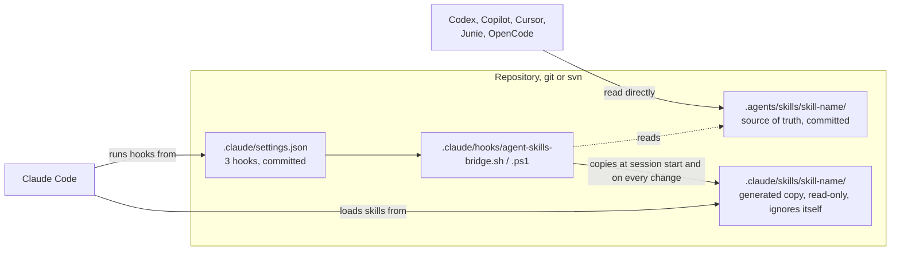

# Agent Skills Bridge: sharing `.agents/skills` with Claude Code

## 1. Summary

Each repository may have one set of project-specific Agent Skills that every AI coding tool on
every developer machine can use. The tool-neutral place for them is `.agents/skills/`.
Codex, GitHub Copilot, Cursor, JetBrains Junie and OpenCode read that folder directly. **Claude Code
does not.** It loads project skills only from `.claude/skills`. That was checked in the Claude Code
2.1.330 program, and no release note up to 2.1.332 changes it. The feature request,
[anthropics/claude-code#31005](https://github.com/anthropics/claude-code/issues/31005), is still
open.

The **Agent Skills Bridge** closes the gap from inside Claude Code. Three hooks, committed in
`.claude/settings.json`, do the work:

- they copy every skill from `.agents/skills` to `.claude/skills` as read-only copies that version
  control ignores;
- they keep those copies in sync while people work;
- they stop Claude from editing a copy by mistake.

Developers install nothing and run nothing. A POSIX shell script and a PowerShell twin cover Windows,
macOS and Linux, in git and in svn. The kit works next to an existing `.claude` folder: its own
settings, hooks and Claude-only skills stay as they are.

**Verification:**
- The automated tests pass on these platforms:
  - Windows 11: Git Bash, and Windows PowerShell 5.1.
  - Ubuntu 24.04: dash, bash and zsh, each used as `sh`.
  - Alpine: BusyBox.
- The tests include git and svn repositories that already have a `.claude` folder.
- The hooks were observed working in live Claude Code 2.1.330 sessions.
- A check from `cmd.exe` confirmed that Claude Code never runs hooks in cmd, and that the kit works for
  people who work in cmd.

---

## 2. Problem and requirements

### Which tool reads which folder (November 2026)

| Tool | Reads `.agents/skills` | Reads `.claude/skills` |
|---|---|---|
| **Claude Code** (CLI, desktop, IDE) | **no** | yes: its only project location |
| OpenAI Codex (CLI, IDE) | yes | no |
| GitHub Copilot (CLI, VS Code, cloud agent) | yes | yes; for the same name, `.agents` wins |
| Cursor (IDE, `cursor-agent`) | yes | yes; both copies are listed |
| JetBrains Junie | yes | no |
| OpenCode | yes | yes; 2.x prefers `.agents`, 1.x lists both with a warning |

### Requirements

- **One source of truth.** Skills live in the repository and are reviewed like code.
- **Every environment.** Windows, macOS and Linux; git and svn; Claude Code in the desktop app and
  in a terminal, whichever shell that terminal runs (cmd, PowerShell, Git Bash, zsh and so on).
- **Fits existing repositories.** It works next to an existing `.claude` folder with its own
  settings, hooks, ignore rules and Claude-only skills.
- **No setup per person.** Nothing to install or remember, not even after a pull or update.
- **No fragile mechanisms.** No symlinks (they need privileges on Windows and break in version
  control), and no generated files in version control.
- **Safe.** It never overwrites or deletes someone's work, and a failure never blocks a session or an
  edit.
- **Cheap.** It can run at every session start, including on Windows machines whose security software
  makes every process start slow.
- **Removable.** Easy to take out once Claude Code reads `.agents/skills` itself.

---

## 3. Solution at a glance



- **Source.** People edit skills only in `.agents/skills/<name>/`.
- **Copy.** `.claude/skills/<name>/` is generated, read-only and recorded in a manifest. It carries
  its own `.gitignore` (`*`), so git ignores it whatever else is in `.claude/skills`.
- **Trigger.** Claude Code's own hooks. There are no git hooks, build steps or installers. The copies
  exist only on machines where Claude Code runs.

---

## 4. How it works

### 4.1 Lifecycle

| When | Hook | What the bridge does |
|---|---|---|
| A session starts (also on resume, `/clear` and compaction) | `SessionStart` | Copies new and changed skills and deletes the copies of removed ones. Then it tells Claude Code to reload skills (`reloadSkills`) and to watch `.agents/skills` (`watchPaths`). Skills are available from the first prompt. |
| A file under `.agents/skills` changes, whether Claude, an IDE, `git pull` or `svn update` changed it | `FileChanged` | Syncs again. Claude Code's skill watcher picks up the new copy within seconds. |
| Claude tries to edit a file in `.claude/skills` | `PreToolUse` | Refuses the edit if the file belongs to a copy, and names the source file to change instead. |

### 4.2 Components

| Path | In version control | Role |
|---|---|---|
| `.agents/skills/<name>/` | yes | The skills, and the only copy anyone edits |
| `.claude/settings.json` | yes | The hooks: `SessionStart`, `FileChanged`, and `PreToolUse` in two entries |
| `.claude/hooks/agent-skills-bridge.sh` | yes | The bridge, in POSIX `sh`, for macOS, Linux and Windows with Git Bash |
| `.claude/hooks/agent-skills-bridge.ps1` | yes | The same bridge for Windows without Git Bash, in PowerShell 5.1 or 7, and the way to run the bridge by hand in cmd or PowerShell |
| `.claude/hooks/agent-skills-bridge.test.sh` | yes | Scenario tests for both implementations |
| `.claude/hooks/agent-skills-bridge.md` | yes | Documentation for maintainers and users |
| `.claude/hooks/.gitattributes` | yes (git) | Keeps the shell scripts LF in every git checkout |
| `.claude/skills/.gitignore` | yes (git) | The **anchor**. It keeps the folder in every checkout and contains only comments |
| `svn:ignore *` on `.claude/skills` | yes (svn) | Keeps the copies out of svn; svn reads no `.gitignore` |
| `.claude/skills/<name>/` | no, ignored | Generated copies, each with its own `.gitignore` |
| `.claude/skills/.agent-skills-bridge/` | no, ignored | The bridge's records (manifest, stamp, lock); the folder ignores itself |

### 4.3 One hook command for every shell

Claude Code runs hooks in `/bin/sh` on macOS and Linux, and in Git Bash on Windows. On Windows
without Git Bash it runs them in PowerShell. It never runs them in `cmd.exe`, and it chooses the shell
itself, so the terminal someone starts it from doesn't matter. Every hook therefore uses a single
command that is valid in both shell families:

```text
set \' ; test -r "$CLAUDE_PROJECT_DIR/.claude/hooks/agent-skills-bridge.sh" || exit 0 ; ASB_CMD=session . "$CLAUDE_PROJECT_DIR/.claude/hooks/agent-skills-bridge.sh" ; exit ; #' ; & "$env:CLAUDE_PROJECT_DIR/.claude/hooks/agent-skills-bridge.ps1" session ; exit $LASTEXITCODE
```

- **POSIX shell.** `\'` is a literal quote. The shell sources the script and exits, and the rest is a
  comment. Should the hook shell be zsh, the script puts it into `sh` emulation first.
- **A hook without its script does nothing.** `test -r ... || exit 0` comes first, because dash and
  BusyBox `ash` end with status 2 when `.` finds no file, and Claude Code reads status 2 from a
  `PreToolUse` hook as a refusal.
- **PowerShell.** `\'...#'` is one quoted argument to `Set-Variable`, so the POSIX half is inert.
  PowerShell runs the `.ps1` file and passes its exit code on.
- **cmd.exe.** A hook's `shell` setting accepts only `bash` and `powershell`, and
  `CLAUDE_CODE_SHELL` and `CLAUDE_CODE_GIT_BASH_PATH` accept only bash, zsh or sh. Claude Code looks
  for Git Bash in `CLAUDE_CODE_GIT_BASH_PATH`, then in the standard Git folders, then in the Git
  installation of the `git` on PATH.
- **Tested** the way Claude Code spawns each shell, including stdin, exit code 2 and paths with
  spaces. The shells: Git Bash, Windows PowerShell 5.1, dash, bash and zsh as `sh`, zsh under its own
  name, and BusyBox `ash`. The hook commands were also run from `cmd.exe` (section 8).

### 4.4 Safety properties

- **It touches only its own copies.** The bridge's records name what it created, and a sync puts a
  copy on record before it makes it. A skill that already exists in `.claude/skills` is reported as a
  conflict and never overwritten.
- **A skill of your own that takes a copy's place stays yours.** Before the bridge deletes or
  replaces a folder, it makes sure that the folder is still the copy it made. The folder must hold
  the `.gitignore` that the bridge wrote, git and svn must track no file in it, and its skill must
  still be in `.agents/skills` or its `SKILL.md` unchanged. Otherwise the bridge leaves the folder
  alone, says so, and takes it off its records. That covers a `git checkout` of a branch that still
  tracks the skill in `.claude/skills`, and a skill that someone moves there by hand. Section 8,
  "Who owns a copy", says where the line runs and why.
- **It never writes through a link.** If `.claude/skills` or a copy is a symlink or a Windows junction,
  the bridge leaves it alone or unlinks it without following it. This matters on Windows, where
  PowerShell 5.1's `Remove-Item -Recurse` and some Java tools delete *through* junctions.
- **Copies are read-only and self-healing.** A copy that was edited or deleted is restored at the next
  sync. One edit is different: a copy whose `.gitignore` was deleted is no longer a copy, because by
  that file the bridge knows its own.
- **Links in a skill are followed.** A copy holds plain files and folders. A link to nowhere, a link
  loop or a file that cannot be read is left out and reported, and the rest of the skill is copied.
  A file that is there but could not be read keeps the sync unfinished until it can be. For a loop
  the shell script relies on `cp`: GNU `cp` leaves it out, BusyBox `cp` follows it 40 folders deep.
- **An unfinished sync never passes for current.** If a copy cannot be replaced or deleted, for
  example because a program holds one of its files open, the bridge says so and the next hook tries
  again. The same holds for a sync that was killed midway.
- **A killed sync leaves no copy without an owner.** Its copies are on record before they exist. The
  next sync makes them again, or deletes them where the skill is gone by then. None is taken for
  someone's own skill.
- **An edit during a sync is not lost.** Each sync writes its time stamp before it looks at the
  skills, and the next sync copies every skill that holds a file changed at or after that stamp. A
  file that changes while a sync is running, for example during a `git pull`, is copied by the next
  hook.
- **Edits are redirected.** The guard refuses Claude's edits to a copy and names the source file. It
  knows the usual spellings of a path: relative, with `.` and `..`, in another letter case, and the
  Git Bash and network forms.
- **Concurrent runs are safe.** A lock serialises them. A lock left by a killed run expires after two
  minutes.
- **It fails open.** A broken bridge never blocks a session or an edit, and a hook whose script is
  missing does nothing. Problems reach the user as a one-line message. One case is out of the
  bridge's hands: a shell script saved with CRLF makes the shell itself end with status 2, and
  Claude Code then refuses every Write until the line endings are repaired.
- **Kill switch.** `AGENT_SKILLS_BRIDGE=off` turns the hooks into no-ops.
- **Nothing gets committed by accident.**
  - git: each copy and the record folder carry their own `.gitignore`. Git ignores them whatever
    other ignore rules say, in fresh clones and worktrees too.
  - The bridge never edits a `.gitignore` that it didn't write.
  - svn: `svn:ignore` on `.claude/skills` does the same.
  - `status` asks git or svn directly whether the copies are really ignored.

### 4.5 Performance

- **Nothing changed** (the common case). Beyond the shell Claude Code opens for the hook, no process
  starts at all. That costs about 0.5 s on a Windows machine where security software makes each
  process start take 0.3 to 1 s, and milliseconds on Linux and macOS.
- **Something changed.** About seven processes, whatever the number of skills, because the copy runs
  as one batch. The first sync of a new checkout took 6.8 s on that slow Windows machine.
- **The guard.** For Edit, Claude Code's `if` filter skips it for every file outside `.claude/skills`.
  A hook's `if` holds one rule, and that rule matches only the Edit tool. So for Write, NotebookEdit
  and MultiEdit the guard starts on each call and exits at once, without starting a program of its
  own.

---

## 5. Support matrix

| Environment | How the bridge runs | Status |
|---|---|---|
| Windows with Git Bash | `sh` script in Git Bash | tests pass; live-checked in Claude desktop |
| Windows without Git Bash | PowerShell twin | tests pass on Windows PowerShell 5.1; PowerShell 7 not run |
| Windows, people who work in cmd | Hooks still run in Git Bash or PowerShell, never cmd. By hand: the PowerShell command in section 6 | checked from cmd.exe (section 8) |
| Linux | `sh` script | tests pass with dash (Debian, Ubuntu), bash as `sh` (Fedora, RHEL, Arch), zsh as `sh`, zsh as the hook shell, and BusyBox (Alpine, containers) |
| macOS | `sh` script (bash 3.2, or zsh if that is the hook shell) | bash 3.2's known pitfalls are handled (see section 8), and zsh is tested on Linux; not run on a Mac |
| git | each copy ignores itself; `.claude/hooks/.gitattributes` keeps the script LF | tested, including a clone with `core.autocrlf=true` |
| svn | `svn:ignore *` on `.claude/skills`, `svn:eol-style LF` on the script | tested |
| An existing `.claude` folder | settings merged by hand; everything else untouched | tested in git and svn (section 6) |
| Claude desktop, plain folder | project root is the folder | live-checked |
| Claude desktop, app worktree | project root is the **main checkout** (see section 7) | live-checked |
| Claude Code in a terminal | project root is the start folder | Same engine as the desktop app. Even the older 2.1.220 CLI has every hook feature the kit uses. Not run live, because the CLI login on the test machine had expired. |
| Claude Code on the web, cloud sessions | Linux container | not checked |

**Other tools on a machine where Claude Code also runs:**

| Effect of the local copy | Tools |
|---|---|
| None: `.claude/skills` is not read, or `.agents` wins | Codex, Junie, Copilot CLI, OpenCode 2.x |
| None: the copies are never in the repository | Copilot cloud agent |
| Each skill listed twice, with identical content | Cursor, OpenCode 1.x, VS Code's deprecated Local harness |

For the tools that list skills twice, switches exist. In the Cursor IDE, turn off the third-party
skills setting. In OpenCode 1.x, set `OPENCODE_DISABLE_CLAUDE_CODE_SKILLS=1`.

---

## 6. Adoption

### git

1. Copy `.claude/hooks/agent-skills-bridge.*`, `.claude/hooks/.gitattributes` and
   `.claude/skills/.gitignore` into the repository.
2. Add the hooks from `.claude/settings.json` to the repository's settings, or copy the file if it has
   none.
3. Put the skills in `.agents/skills/<name>/SKILL.md` and commit.

### svn

Copy the same files, except the two git files. Then run:

```sh
svn add --parents .claude/settings.json .claude/hooks/agent-skills-bridge.* .agents
svn mkdir --parents .claude/skills
printf '*\n' > svn-ignore.txt && svn propset svn:ignore -F svn-ignore.txt .claude/skills && rm svn-ignore.txt
svn propset svn:eol-style LF .claude/hooks/agent-skills-bridge.sh .claude/hooks/agent-skills-bridge.test.sh
svn commit -m "Share .agents/skills with Claude Code"
```

On Windows, `svn.exe` expands a `*` on its own command line, even inside quotes. The ignore value
must therefore come from a file (`-F`), or be set in TortoiseSVN's Properties dialog.

### Next to an existing `.claude` folder

| Already there | What to do |
|---|---|
| `.claude/settings.json` | Add the bridge's four hook entries next to your own: one for `SessionStart`, one for `FileChanged` and two for `PreToolUse`. Claude Code runs all matching hooks. Claude Code itself can do the merge. |
| Other hooks in `.claude/hooks` | Nothing. The kit's file names start with `agent-skills-bridge`. |
| Claude-only skills in `.claude/skills` | git: nothing; the copies ignore only themselves. svn: add a new skill folder by name, since `svn:ignore` hides the folder's direct entries. |
| A `.claude/skills/.gitignore` with your own rules | Keep it. The bridge never edits it and needs no line in it. |
| A skill with the same name in both folders | Reported as a conflict, and both are left alone. |
| A branch that still tracks a skill in `.claude/skills`, next to a branch that has moved it | On that branch the tracked skill is left alone and reported once. Back on the other branch the copy is made again. |
| `.claude/skills` as a link (the usual hand-made workaround) | Left alone and reported. Delete the link to switch to the bridge. |
| A root `.gitignore` that ignores `.claude/` | Replace the rule with `.claude/*`, `!.claude/settings.json`, `!.claude/hooks/` and `!.claude/skills/`. `settings.local.json` stays ignored. |

The kit's documentation has a merged `settings.json` example.

### Check a repository

```sh
sh .claude/hooks/agent-skills-bridge.sh status
```

In cmd or PowerShell on Windows, `sh` is usually not on PATH: Git for Windows adds only its `cmd`
folder by default. There, use the PowerShell twin, with or without Git Bash:

```text
powershell -NoProfile -ExecutionPolicy Bypass -File .claude\hooks\agent-skills-bridge.ps1 status
```

`status` reports:
- the skills, the copies and whether they are current;
- any conflicts;
- skill names that break the Agent Skills spec;
- whether git or svn really ignores the copies, and whether `.claude/skills` is in the repository;
- whether the hooks are in place.

Both scripts take the same commands: `status`, `sync` and `clean`.

### Check it by hand

The kit's documentation has a step-by-step manual test, "Manual test", for Claude desktop and for the
terminal CLI. It takes about ten minutes and assumes no knowledge of the kit. A throwaway skill,
`bridge-check`, shows that:

1. a new session copies the skill to `.claude/skills`;
2. Claude Code knows it: typing `/bridge-check` gets the answer `BRIDGE CHECK OK - version 1`;
3. a change to the skill reaches the running session (`version 2`);
4. Claude can't edit the copy: the guard's message appears instead;
5. git or svn never sees the copy;
6. deleting the skill deletes the copy.

Each step gives the exact commands for Windows and for macOS, Linux and Git Bash, and says what you
should see. A closing table names the likely cause and the fix for each failed check.

---

## 7. Claude desktop worktree sessions

The Claude desktop app starts sessions in its own worktrees (`.claude/worktrees/<name>`) with
`--project-config-root` set to the **main checkout**. Hooks, project settings, project skills and
`CLAUDE_PROJECT_DIR` therefore all come from the main checkout. The live check confirmed that the
bridge follows the same rule.

- **Where the kit must be.** Merge it to the branch that the main checkout has checked out. A kit
  that exists only on a worktree branch does nothing in worktree sessions.
- **Which skills a worktree session sees.** It sees the main checkout's skills. A skill changed only
  on the worktree branch appears once the main checkout has that change. Skill authors can also test
  from a terminal `claude` started inside the worktree, where the worktree is the project root.
- **Which guard answers.** The desktop app refuses the model's edits to the main checkout from a
  worktree session, so the app's guard answers before the bridge's.
- **This is not specific to the bridge.** Plain `.claude/settings.json` and `.claude/skills` content
  behaves the same way in these sessions.

---

## 8. Verification evidence

### Automated tests

The tests run the exact hook commands from `.claude/settings.json`, the way Claude Code runs them.
They cover:

- the first sync, edits, removals (including a sync that only deletes) and conflicts;
- a sync with nothing to do, which must start no program;
- read-only copies, and repair after tampering or deletion;
- the guard, for Edit, Write, NotebookEdit and MultiEdit: one copy and two, relative paths, `.` and
  `..`, other letter cases, the Git Bash and network spellings, and events with blanks in their JSON;
- symlinks, junctions and link loops in a skill, links to nowhere, a junction up to the repository, a
  junction to a junction, and a junction or a read-only folder inside a copy;
- a copy that cannot be replaced or deleted, and a file that cannot be copied at first and can later;
- hooks whose script is missing, and a skill folder with a name the bridge cannot use;
- an edit that lands while a sync is running;
- a sync that is killed: midway, after it made a new copy, before a copy has its `.gitignore`, and
  after it could not replace a copy;
- a sync that cannot write its stamp, and one whose manifest does not arrive;
- a session that starts while another sync makes a new copy;
- what a killed sync of the PowerShell twin leaves in the records;
- `clean` after a first sync that left no manifest, because it was killed or because its manifest
  did not arrive;
- a skill of someone's own that takes the place of a copy: put there by git, when a branch is checked
  out that tracks it in `.claude/skills`, or moved there by hand, each with `sync` and with `clean`;
- the cases next to it: a branch that has the skill in both places, a git that is at work, a git
  that fails, a folder that git tracks under a name in another letter case, a skill that a file
  manager moves over its copy, a copy whose `SKILL.md` was changed before its skill went, a copy
  that only gained a file, and a file or an empty folder in the place of a copy;
- the way back to the branch that has the skill in `.agents/skills`, where the copy is made again;
- a sync that finds a skill of someone's own and is killed, records that the scripts of before left
  unfinished, and records that were lost;
- a stale lock, the kill switch, and paths with spaces, with a letter outside ASCII, and on a network
  share;
- files saved with CRLF, read-only folders, `CDPATH`, and zsh with an alias and an option from
  `.zshenv`;
- `status` and `clean`;
- git: an existing `.claude/skills` with its own skill and `.gitignore`. Git sees the native skill's
  files but no copy and no record. `status` names a copy that someone added to git, and a copy that
  lost its `.gitignore`, which the bridge leaves alone from then on.
- git: a clone with `core.autocrlf=true` keeps the script LF thanks to `.claude/hooks/.gitattributes`,
  with a control clone that proves the conversion happens without it;
- svn: `status` names what svn would add, `svn:ignore` hides the copies, and a native skill can still
  be added and keeps showing new files. A changed copy that someone added to svn is left alone.

| Platform | Result |
|---|---|
| Windows 11, Git Bash | 304 / 304 passed (Windows has no symlinks for the link cases) |
| Windows 11, Windows PowerShell 5.1 | 301 / 301 passed |
| Ubuntu 24.04 (WSL2), dash | 287 / 287 passed |
| Ubuntu 24.04 (WSL2), bash 5.2 as `sh` | 287 / 287 passed |
| Ubuntu 24.04 (WSL2), zsh 5.9 as `sh` | 287 / 287 passed |
| Ubuntu 24.04 (WSL2), zsh 5.9 as the hook shell | 289 / 289 passed |
| Alpine 3.24 container, BusyBox 1.37 | 233 / 233 passed (no git, svn or node in the image) |

A case that needs something the system lacks is skipped: symlinks and file modes on Windows, junctions
and network paths elsewhere.

### Code review (25 November 2026)

A reviewer went through the kit platform by platform. A second, adversarial review of the fixes
followed, with every finding reproduced before it was accepted. All of the findings below are fixed.
Each but the OneDrive one has a test that failed on the kit as it was: 39 checks failed there in
dash, 66 with zsh as the hook shell and 27 in Windows PowerShell. For OneDrive, the link test was
checked against the entries of a OneDrive folder, but no sync has run inside one.

| Finding | Fix |
|---|---|
| zsh as the hook shell splits no words and fails on a pattern without a match, so nothing was copied. | The script puts zsh into `sh` emulation and turns alias expansion off. |
| dash misread a manifest or a `SKILL.md` saved with CRLF, and took the bridge's own copies for someone else's. | Carriage returns are dropped in every shell, without a process. |
| `CDPATH` could send `cd` to another folder. | The script clears it. |
| Linux: a read-only folder in a skill made its copy impossible to replace. | The bridge makes such a copy writable before it deletes it. |
| The guard missed paths with `.` or `..`, relative paths, Git Bash's `/c/...`, network paths, another letter case in the skill's name, and events with blanks in their JSON. | Both guards bring the path into one form first. A relative path counts from the folder the event names. |
| MultiEdit sat behind an `if` filter that matches only Edit. | It moved to the guard entry without a filter. |
| PowerShell: a junction loop in a skill sent `-Recurse` down to the path limit and left a nested copy. An edit behind a junction went unnoticed. | The twin walks folders itself. It follows the links in a skill and leaves a loop out. |
| PowerShell: in a OneDrive folder every file and folder counted as a link, so the bridge did nothing there. | Only junctions and symbolic links count as links. |
| PowerShell: stdin and stdout went through the console code page, so a letter outside ASCII in the repository path broke the guard and the watch path. | The twin reads and writes UTF-8. |
| Both: a copy that could not be replaced, because a file in it was open, stayed half deleted and passed for current. A skill whose `SKILL.md` could not be read left a half copy. | Such a sync counts as unfinished and the next hook repeats it. Half copies are deleted. `clean` keeps its records until every copy is gone. |
| dash and BusyBox: a link to nowhere in a skill made every hook copy that skill again. | Such a link counts for nothing, and is reported once when the skill is copied. |

Two limits remain, both outside what Claude Code sends:

- The guard compares spellings. A `\\?\` path, a short 8.3 name or a link that leads into a copy gets
  past it; the next sync then replaces the edited copy.
- The shell guard finds the path with string operations. Claude Code puts the path first in an
  event. If it came after a very large value, the guard would need seconds per 100 KB to find it.

### Portability review (25 November 2026)

A review against the question "Windows and Linux, git and svn, CLI and desktop, existing `.claude`
folders" found these problems. All of them are fixed and covered by the tests above.

| Finding | Fix |
|---|---|
| The old anchor (`*` in `.claude/skills/.gitignore`) hid new files of Claude-only skills in `.claude/skills` from git. | Each copy ignores itself. The anchor now ignores nothing. |
| With an existing `.claude/skills/.gitignore`, the bridge kept that file. The copies were then visible to git and could be committed, while `status` reported the anchor as present. | Copies no longer depend on that file. `status` asks `git check-ignore` and `svn status` directly. |
| macOS `sh` is bash 3.2. Under `set -u` it rejects an empty `"$@"`, which a sync that only deletes copies produced. | `${1+"$@"}`. A test now checks that a delete-only sync succeeds; bash 3.2 itself was not run. |
| LF line endings depended on a manual edit of the root `.gitattributes`. A CRLF script fails in dash (checked); Git Bash copes. | The kit ships `.claude/hooks/.gitattributes`. |
| The PowerShell `status` crashed in a non-svn repository on machines with svn installed: Windows PowerShell 5.1 turns redirected stderr into a fatal error under `Stop` (checked). | A helper runs git and svn without that effect. A test now checks that `status` runs to the end. |
| Test harness: BusyBox compares file times in whole seconds, and zsh keeps an assignment made in front of a function call. | The tests now allow for both. The bridge itself was unaffected. |

### An edit during a sync (26 November 2026)

The code review had noticed one more problem and left it for a change of its own, because the fix
changes how a sync writes its records.

| Finding | Fix |
|---|---|
| Both: a sync wrote its time stamp after it had looked at every skill. A file that was edited in between, for example by a `git pull` that was still running, was older than the stamp. No later sync copied it, and the copy stayed out of date until the skill changed again. | The stamp is written before the look, under another name, so that the look still compares with the stamp of the sync before. It goes into the records together with the manifest when the sync ends. |

- **No extra process.** A shell cannot set a file's time without starting a program. So the shell
  script writes the new stamp into its lock folder and moves it with the `mv` that already moved the
  manifest. A sync with work to do starts as many programs as before, and one with nothing to do
  still starts none.
- **The file system's clock.** PowerShell could set the stamp's time from its own clock, but the
  twin writes a file too. On the test machine, in 2,016 of 3,000 writes the file's time was behind
  the precise system clock, by up to 14 ms. That is the clock PowerShell 7 reads for
  `[DateTime]::UtcNow`, so a stamp set from it could be later than an edit that came after it. On a
  network share, the server stamps the files.
- **An unfinished sync.** While a sync works, the stamp in the records is still newer than the
  manifest, as before, so a sync that is killed counts as unfinished. So does a sync whose stamp or
  manifest does not arrive at the end. The next sync makes every copy again. What that stamp holds,
  and in which order the two arrive, changed once more the same day: see "A sync that is killed
  after a new copy" below.
- **The test** runs a sync whose script carries one more line: after the look at the skills, it
  edits a skill that the look found unchanged. No file time set by hand can stand in for that,
  because the moment lies inside one run. The test fails on the scripts of the code review, in dash,
  BusyBox and Windows PowerShell 5.1, and passes now. A second test kills a sync between its last
  copy and its manifest and checks that the next plan calls every copy out of date.
- **With real processes.** In dash on Ubuntu, one process edited 600 skills, about one edit a
  millisecond, while two others ran sync after sync. When the edits stopped, one more sync had to
  bring every copy up to date. With the scripts of the code review, 36, 78 and 30 copies stayed out
  of date in three rounds. With the scripts as they are now, none did.
- **Old records.** Both scripts read the records that the earlier scripts wrote, and the earlier
  scripts read the new ones (checked by hand on Windows, in both directions).

### Second review (26 November 2026)

An independent review of the code review's commit followed, from four angles: the shell script's
sync, both guards, the PowerShell twin's sync, and the tests and documents. The findings below are
fixed, and each has a test. Of the new checks, 8 fail on the kit as it was before this review in
dash, 10 with zsh as the hook shell and 17 in Windows PowerShell.

| Finding | Fix |
|---|---|
| PowerShell: with two or more copies, the guard's refusal named all of them at once (`.agents/skills/alpha beta/SKILL.md`). | The list of copies is read name by name. |
| PowerShell: a junction in a skill that leads up to the repository took the bridge into its own `.claude/skills`. It copied its copy until the depth limit, and the skill lost its copy. | The bridge's own folder is no part of a skill: it is left out of the copy and of the search for changes. |
| PowerShell: a junction to a junction was followed one step only, so a file deleted at the end of the chain stayed in the copy. | Links are followed to their end. |
| PowerShell: a folder with the read-only attribute inside a copy could not be replaced. | The attribute is lifted from folders too. |
| PowerShell: `status` and `clean` went through a pipe in the console code page. | They write UTF-8, like the hook answers. |
| The hook command: where `sh` is dash or BusyBox `ash`, a missing script ended the shell with status 2, and Claude Code refused every Write. | The command tests for the script first and does nothing without it. |
| A file that could not be read was left out of a copy for good, also once it could be read. | Such a sync counts as unfinished, and the next hook tries again. |
| zsh as the hook shell kept the options set in `~/.zshenv`; `markdirs` stopped every copy. | Every option goes back to its `sh` default. |
| The note about a skill folder with an unusable name came with every file event, and twice in a hook that copied. | It comes once per session. |
| `clean` left the record folder behind when the last sync had deleted the last copy. | It deletes that folder too. |
| The shell guard named the source file in lower case when the event and the repository differed in letter case. | The message keeps the event's spelling. |
| Tests and documents: some checks could not fail, the suite left files behind when it was interrupted, and the documents said that a link loop is always left out. | `settings.json` is read entry by entry, a link loop must leave no runaway copy where `cp` sees it, and the file holder ends by itself. The documents now say what BusyBox `cp` does. |

These findings are open. They are older than both reviews, and each needs a decision before a fix:

- **A file replaced by an older one.** The bridge compares file times with its stamp, not with the
  copy. A file put in place with an older time (`cp -p`, a Windows copy, `tar`, `rsync -a`) is not
  copied until something else in the skill changes.
- **A skill renamed in letter case only**, where the file system ignores case: the shell script
  reports a conflict and deletes the copy first; the PowerShell twin keeps the old name.
- **Waiting for a lock.** Each try starts three programs. On a slow Windows machine the wait takes
  about 115 s, close to the hook's timeout of 120 s.
- **The Edit filter on Windows.** Read from the Claude Code 2.1.330 program, not confirmed in a live
  session: after a `cd` in the session, the rule `Edit(**/.claude/skills/**)` no longer matches a
  Windows path, so the guard does not start for Edit. The copies stay read-only, and the next sync
  repairs an edited one.
- **A link from a skill up to the repository, in the shell script.** The PowerShell twin copies the
  repository once, without its own folder. The shell script leaves the link to `cp`, and GNU `cp`
  may refuse the whole skill, which then has no copy until the link is gone.
- **Smaller ones.** A repository path with a control character or, outside Windows, a backslash
  breaks the watch path. A deleted target of a junction leaves its files in the copy until the
  skill changes. In Git Bash the guard needs about four seconds to read an event of 1 MB.

The review left two more findings open, which are closed since.

- **A sync that is killed during its first copy.** The names of new copies reached the manifest only
  when the sync ended. After a kill they counted as someone else's and were never updated, and a
  second session that started while the first sync still copied reported the same false conflicts.
  The next section describes the fix.
- **Who owns a copy.** The bridge's records alone said which folders in `.claude/skills` were the
  bridge's. If a skill of your own took a copy's place, the bridge deleted or overwrote it. This was
  the most serious of the open findings, the only one that could lose someone's work. "Who owns a
  copy" below describes the fix.

### A sync that is killed after a new copy (26 November 2026)

The work on the time stamp turned up one more weakness, and the second review found it too. It was
older than both, and it got a change of its own, because the fix changes what the bridge records and
when.

| Finding | Fix |
|---|---|
| Both: a sync made its copies and wrote the manifest last. In between, a copy that was new had no entry in the manifest, and whoever looked then took it for someone's own skill. A session hook that started in that time reported a conflict where there was none. If the sync was killed in that time, because the hook's two minutes were over or someone closed Claude Code, the conflict stayed: the next sync reported it, never copied that skill again, and `clean` left the copy behind. After a first sync that was killed, that held for every skill. | Before a sync copies, it writes the names of the bridge's copies into its stamp, the ones it is about to make among them. Until its manifest is in place, every plan, the guard and `clean` read the names from there. |

- **Why a record, and not a mark in the copy.** The other way would have been to recognise a copy by
  the `.gitignore` that the bridge writes into it. It was rejected for three reasons.
  - The mark comes too late. The file is written after the skill's files, and the shell script
    copies all skills with one `cp`. A kill during the copy, which is the longest step, leaves copies
    without it.
  - The mark says too much. Any folder that holds the file would be the bridge's, at any time: a
    copy that someone committed, or one carried over from another checkout.
  - A copy whose skill is deleted after the kill would be in no record. No sync would delete it, and
    `clean` would have to search every folder in `.claude/skills`.

  A record is written before the copy exists, so it holds for a kill at any moment. The rule stays
  the one it was: a folder is the bridge's when the bridge's records name it. (Since "Who owns a
  copy" below, the records are needed and no longer enough: the folder must hold that `.gitignore`
  too, except where the records say that a sync left it half-done.)
- **What the stamp holds.** The stamp of a sync that has ended is empty, as before. The stamp of a
  sync that has begun holds a comment line and the name of every copy of the bridge, one on a line:
  the copies in the manifest and the new ones. A stamp with text marks a sync as unfinished. The
  comparison of file times stays, for records that the scripts of before wrote. A killed sync of the
  scripts as they are now is recognised without it, also where file times count in whole seconds and
  the sync before ended in the same second.
- **The order at the end.** The manifest now goes into the records first and the empty stamp second.
  The names stay on record until the manifest lists them, and a stop between the two still reads as
  unfinished. If the manifest cannot be put in place, for example because a program holds the old one
  open, the stamp with the names stays too. The scripts of before marked such a sync as unfinished
  and left its new copy without a record, as a kill did.
- **No extra process.** The names are written with the shell's own `printf` and read with its
  `read`, and only a stamp that is not empty is read at all. A sync with nothing to do still starts
  no program, and a sync with work starts as many as before. Counted in dash, before and after: 7
  for a sync that copies, 4 for one that only deletes a copy.
- **Without the record, no copy.** If the stamp cannot be written, the sync says so and copies
  nothing.
- **Someone's own skill.** A sync puts a name on record only if it found no folder of that name. A
  skill that someone keeps in `.claude/skills` is therefore never on record: it is a conflict before
  a kill and after it, and `clean` leaves it alone. One limit remains. From a kill until the next
  sync, the names that the killed sync put on record are the bridge's. A folder that someone creates
  under such a name in that time is replaced by the copy. The same happens to a folder that someone
  puts in the place of a finished copy. All three cases were checked by hand in dash. (The last one
  was the open finding "Who owns a copy". It is closed since, and the limit before it is narrower:
  see that section below.)
- **Tests.** Four scenarios use the helper that makes a test repository's script run one more line.
  The first kills a sync after its last copy, where one copy is new. The second kills a first sync
  when a copy has its files and not yet its `.gitignore`, and deletes that skill before the next
  sync. The third takes the manifest away before it can be put in place. The fourth makes a sync
  wait before it writes its manifest, and lets a session hook come in meanwhile. In each, no hook
  reports a conflict, and the copy ends up in the manifest or is deleted. A skill of someone's own
  that has the name of a skill in `.agents/skills` is still reported, and kept, also by `clean`,
  which deletes the copy of a killed sync. Against the scripts as they were until then, 19 of the new
  checks fail in dash and 14 in Windows PowerShell 5.1. In BusyBox 20 of them fail, and one older
  check with them: the test that kills a sync midway no longer waits a second first, and without
  that pause those scripts take the killed sync for finished, because BusyBox compares file times in
  whole seconds.
- **With real processes.** In dash on Ubuntu, a first sync of 3,000 skills ran for about five
  seconds while twelve session hooks came in. With the scripts as they were until then, all twelve
  reported conflicts. With the scripts as they are now, none did. The check of "An edit during a
  sync" was repeated too, with the new order at the end: in three rounds, no copy stayed out of date.
- **Both scripts, and old records.** Checked by hand on Windows. A sync of the shell script was
  killed after a new copy, and the PowerShell twin took over; then the other way round. Each finished
  the other's work without a conflict. Both scripts read the records of the scripts of before, and
  those scripts read the new records: they ignore the text in a stamp and still see a killed sync as
  unfinished, by its time. Two things stay as they were. A copy that a killed sync of the scripts of
  before left behind is in no record, so it stays a conflict until someone deletes the folder. And
  if the scripts of before sync after a kill of the new ones, they empty the stamp, and the new copy
  is a conflict from then on. (Since "Who owns a copy" below, the bridge takes a whole copy back
  that is in no record. Only half a copy stays a conflict.)

### Two smaller gaps in the records (26 November 2026)

The work on the records left two smaller gaps. Both are closed, each with a test.

| Finding | Fix |
|---|---|
| Both: a sync that could not replace or delete a copy put its manifest and the empty stamp in place, and deleted the stamp afterwards. If it was killed in between, it passed for finished, and the copy that it had left half deleted passed for current. In the shell script the gap was as wide as the start of one more program. | After such a sync the empty stamp stays out of the records, and the stamp of the sync that has begun goes on marking it as unfinished. That stamp is deleted once the manifest is in place, only for the scripts of before, which go by the times of the two files. |
| PowerShell: the twin's lock is a file and not a folder, so it keeps its waiting stamp, and the manifest on its way, next to the records. A kill left them there, and the shell script never removed them. | The shell script deletes them with the `rm` that removes its lock, so it starts no more programs than before. The twin now also deletes the manifest on its way when it could not put it in place. |

- **Tests.** One scenario holds a copy so that it cannot be replaced, and kills the sync when its
  manifest is in place and its stamp not yet deleted. `status` must not call the copies current, and
  the next sync must replace the copy. The other puts the twin's two files into the records and runs
  a sync. Against the scripts of the step before, 3 of these checks fail in dash and in BusyBox, and
  2 in Windows PowerShell 5.1, which always cleared its own two files. In dash the copy that passed
  for current there was an empty folder.
- **Checked again** with the scripts as they are now: the count of programs (7 and 4), the two
  checks with real processes, and the two scripts taking over from each other. After a killed sync
  of the twin, the shell script now leaves nothing but the manifest and the stamp in the records.

### `clean` without a manifest (26 November 2026)

The second review and the work on the records were done side by side, from the same state of the
kit, and both changed how `clean` begins. Each added a case in which there is no manifest:

| Case | What `clean` does |
|---|---|
| The last sync deleted the last copy. It deleted its manifest too and left the record folder behind. | It deletes the record folder (second review). |
| The first sync never wrote a manifest: it was killed, or the manifest could not be put in place. Its stamp names the copies. | It deletes those copies, and then the records (the work on the records). |

- **Why the order matters.** The two cases look alike. If `clean` took the second for the first, it
  would delete the records and leave the copies. No sync would touch those again: every later plan
  would take them for someone's own skills. So `clean` reads the names in the records first. It
  deletes a record folder by itself only when no record names a copy and no lock says that a sync is
  at work.
- **The test** runs `clean` after a first sync that was killed after its last copy, and after one
  whose manifest did not arrive and that left no lock. In both, a skill of someone's own that has
  the name of a skill in `.agents/skills` must stay. Against the scripts of the second review alone,
  5 of the 12 checks fail: after the kill nothing is deleted, and without the lock the records go
  and the copies stay. Against the scripts from before both, 6 fail. The numbers are the same in
  all seven environments. With the work on the records alone all 12 pass, because the second case
  came with it.
- **Checked by hand** in dash, Git Bash and Windows PowerShell 5.1, in four states of the records
  without a manifest: the two above, a stamp that was cut short and names no copy, and the same with
  a lock.

### Who owns a copy (26 November 2026)

The second review left this finding open, because its fix decides what the bridge takes for its
own. It was the only open finding that could lose someone's work.

| Finding | Fix |
|---|---|
| Both: the bridge's records alone said which folders in `.claude/skills` were its copies. A name on record without a skill in `.agents/skills` was deleted, and one whose folder had changed was replaced. Nothing checked that the folder was still the copy that the bridge had made. So a skill of someone's own that took a copy's place was deleted or overwritten, and the hook said nothing. `clean` trusted the records in the same way. | Before the bridge deletes or replaces a folder, it makes sure that the folder is still its copy. If it is not, the bridge leaves it alone, reports it and takes the name off its records. `clean` does the same. |

Two ways to lose a skill were reproduced, in dash and in Git Bash:

- **With git.** One branch tracks `.claude/skills/foo/SKILL.md`. Another has moved the skill to
  `.agents/skills/foo`, which is the move the kit is made for. After a sync on the second branch,
  `git checkout` of the first puts the tracked file over the ignored copy without a word. The
  copy's own `.gitignore` stays in the folder, and so does every file of the copy that the first
  branch does not have. The next hook deleted the folder, and with it the tracked file and every
  edit in it that was not committed.
- **By hand.** Someone deletes the read-only copy and moves the skill from `.agents/skills` into
  its place. The next hook deleted it, and the skill was in neither folder.

**Where the line runs.** A folder that the records name is still the bridge's copy while three more
things hold:

1. **It holds the `.gitignore` that the bridge wrote.** The bridge knows the file by its first
   line. Every kit since the first has written that line, as the last file of a copy. Whoever
   replaces the folder replaces the file too, so this settles the move by hand, with one `read`.
2. **Its skill is still in `.agents/skills`, or its `SKILL.md` is as the bridge copied it.**
3. **git and svn track no file in it.** After a checkout the first sign is still there, because
   git leaves the `.gitignore` where it was. So the bridge asks them: `git ls-files`, once for all
   the folders in question, and `svn info`.

A folder that fails one of them is someone's own. Whatever else differs in a folder that passes
them is an edit of a copy, and the bridge undoes it as before: it restores the copy from its skill,
and deletes it once the skill is gone. The "repair" tests pass unchanged.

- **Why there.** A copy is generated and read-only, and the guard sends every edit to the
  original. So a change inside a copy is a slip, and the original is there to undo it from. That
  ends where the original is gone and the copy's `SKILL.md` has changed: the changed text exists
  nowhere else, and deleting it would be the very loss this finding is about. A tracked file is
  committed work, whatever else the folder holds.
- **What was weighed.** The review named three signs. Each falls short alone.
  - The `.gitignore` misses the git case, where it stays behind. It is also missing from a copy
    that a killed sync left half-made, which is why "A sync that is killed after a new copy" did
    not rely on it. The records now name those folders (see below), so every other folder can be
    asked for the file.
  - "Anything newer than the manifest, where the skill is gone" needs no process and catches the
    git case. But it would also keep the copy of a removed skill whenever a file had turned up in
    it, such as the `__pycache__` of a script that ran there, and Claude Code would go on listing
    a skill that the team has removed. So only `SKILL.md` counts.
  - Asking git is exact, and costs a process. So git is asked last, and only about a folder that
    holds a file which the bridge did not put there.
- **Times are compared with the copy's own `.gitignore`,** not with the manifest. The bridge writes
  that file last, so nothing it put into the folder is newer, and whatever a checkout or an editor
  writes later is. The manifest is the wrong measure: every sync writes it anew, and after a sync
  that did not finish it says nothing about the copies. The PowerShell twin gives a copy the time
  of its original. Where that time lies ahead of the clock, the twin now sets it back to the time
  of the `.gitignore`.
- **A file that can be written is not the bridge's either.** The bridge leaves every file of a copy
  read-only, its `.gitignore` among them. A file manager that moves a skill over its copy merges
  the two folders: the `.gitignore` stays, and the moved files keep their old times. They can be
  written, though, and so can whatever git checks out, also in the very second of a sync where a
  shell compares whole seconds. So a file in a copy that can be written counts like a newer one.
  The sign holds only while the `.gitignore` itself is still read-only. Where it can be written,
  root is at work or the file system keeps no such mark, and the sign is left out. It is also left
  out for a copy that a killed sync may have left before it made the files read-only.
- **No extra process in an ordinary sync.** Counted in dash, before and after: none for a hook with
  nothing to do, 7 for a sync that copies, 4 for one that only deletes a copy. A sync that finds a
  copy with a file in it that the bridge did not put there starts one more, the `git`, and only
  below a folder that holds `.git`. A sync that takes a folder off its records starts 3. After
  that the folder costs a hook nothing: the tests run the next hook with a `PATH` that leads
  nowhere.
- **Where git cannot answer.** While git checks a branch out, its index is still the one of the
  branch before: it writes the index last. A hook that runs meanwhile, which a long checkout makes
  likely, would get a wrong answer. Git holds a lock on its index for all that time, so the bridge
  looks for the lock first, also in the folder that a worktree's `.git` file names. If the lock is
  there, the sync changes nothing, says that it waits, and leaves the work to the next hook. A git
  that fails, because it does not trust the checkout or is too old, is like no git at all: the
  bridge goes by the first two signs. Taking a folder off the records for that reason was tried
  and dropped: where git fails for good, every copy that a script had left a file in would have
  stopped being a copy.
- **Letter case.** Windows and macOS take a folder in another letter case for the same one, so
  git's files can lie in the copy's folder under such a name. The bridge cannot tell what the file
  system does, so it asks git without regard to letter case, as the guard compares paths. The
  PowerShell twin, which takes names in another letter case for one name everywhere, knows its
  `.gitignore` in the same way: a skill that is renamed in letter case only keeps its copy there,
  as before.
- **A folder that a sync left half-done.** A sync that is killed while it copies leaves folders
  without the `.gitignore`, and a sync that cannot delete a copy leaves half of it. The records now
  say which folders those may be. The stamp of a sync that has begun starts with a line
  `# Unfinished:` and the names of the copies that the sync is about to delete or to make. The
  manifest of a sync that could not finish has the same line, for what it left behind. The next
  sync does not ask these folders for the `.gitignore`: it asks git about them, and it asks every
  other folder for the file. So a decision holds after a kill. A test kills the sync that has just
  found a skill of someone's own, and the next sync leaves that skill alone as well.
- **`clean`** makes the same check. Like a sync, it first puts on record what it is about to
  delete, so a `clean` that is killed, or that cannot delete a copy, leaves no half-deleted folder
  that would pass for someone's own.
- **No copy without its `.gitignore`.** If the shell script cannot write that file into a new
  copy, it now deletes the copy and tries again at the next hook, as the PowerShell twin did
  already. Before, it kept the copy and said that git may list it.
- **The way back.** When the bridge has left a folder to git and the branch is switched back, git
  takes its files out again. What stays is the rest of the old copy: the `.gitignore` and the
  files that the other branch did not have. No record names that folder, and before this change it
  would have been a conflict for good. The bridge now tells such a rest from a skill of someone's
  own. A folder that holds the bridge's `.gitignore` and no file that the bridge did not put
  there, or that holds nothing, is replaced by the copy. So switching back and forth needs no
  hand. The same rule takes
  back a copy whose records were lost, and a whole copy that a kit from before 26 November 2026
  left without a record. A copy in no record that someone changed stays a conflict.
- **Old records.** The scripts of before read past the new line, which is a comment to them. Their
  own unfinished records have no such line, so after them any folder on record may be half-done,
  as it was. This was checked on Windows with a script of 46 checks. The shell script and the twin
  ran on one checkout: each left a skill alone that had taken the place of the other's copy, and
  each finished a sync of the other that was killed before a copy had its `.gitignore`. The new
  scripts ran on records of the scripts of before, finished ones and ones of a killed sync. And
  the scripts of before ran on the new records, the new stamp and the new manifest line among
  them.
- **Tests.** Section 35 of the suite plays the git case through: the checkout, an edit that is not
  committed, the hook, the way back, a branch that has the skill in both places, `clean`, a git
  that is at work, a git that fails, and a folder that git tracks under a name in another letter
  case. Section 36 has the move by hand, the same move by a file manager that merges the folders,
  and the cases next to them. 37 has `clean` after such a move, 38 has the kill, and 39 has records
  of before and records that were lost. Against the scripts as they were, 40 of these checks fail
  in dash, with zsh as the hook shell and in Windows PowerShell 5.1, and 20 in BusyBox, which has
  no git and no svn. One older test changed with the rule: a copy whose `.gitignore` was deleted
  was restored before, and is now left alone and reported.
- **A review of the fix.** An independent, adversarial review of the first version of this change
  reproduced what it found before it was accepted, as the reviews before it did. Fixed since: the
  shell guard lost the file's name in its message while the records were those of a sync that had
  begun; a skill that a file manager moved over its copy was still deleted; a hook that ran during
  a long checkout got git's answer of the branch before; and a git that failed made copies stop
  being copies. The review also killed a sync and a `clean` after every line of the shell script
  that they pass through. That was repeated in dash on the scripts as they are now: 511 kills took
  effect, and after each of them the next sync left the skills of someone's own where they were,
  took no copy for someone's own, and finished the work.
- **Limits.** The bridge can only be as sure as its signs are.
  - A file that someone puts into a copy read-only and with an older time does not count as
    theirs, and what happens to it is what happens to an edit of a copy. Where every file can be
    written, as for root, the read-only sign is left out and only the times count: then neither
    does a file that keeps an older time (`cp -p`, a Windows copy, `tar`, `rsync -a`, a move), nor,
    where a shell compares whole seconds (BusyBox, bash 3.2), one that is written in the very
    second in which the copy was made.
  - Where the hook's shell finds no git or svn, or a git that fails, a tracked folder is safe when
    its skill is gone from `.agents/skills`, as on a branch from before the move. On a branch that
    has the skill in both places, it looks like an edited copy and is replaced.
  - After a sync that was killed, a folder that someone creates under the name of a copy that this
    sync was deleting or making is replaced by the next sync, unless git tracks it.
  - A copy whose `SKILL.md` someone changed is kept on a branch that does not have its skill. Back
    on the branch that has the skill, the folder is a conflict until someone deletes it.
  - In a folder that the bridge left to git, the copy's `.gitignore` stays behind, with the files
    of the copy that the branch does not have. Git ignores them, and every new file there, until
    someone deletes that `.gitignore`. The bridge says so when it lets go of the folder. Taking
    the file out would break the way back, and git would list the rest of the copy.
  - The guard goes by the records. Until the next sync has looked, it refuses Claude's edits in a
    folder that is no longer a copy.
  - A folder in no record that looks like an untouched copy is replaced also where git tracks it,
    because someone committed a copy. It holds what the bridge copied, so nothing of anyone's is
    lost, and `status` names such a copy as not ignored.

### Adoption flows

| Flow | Result |
|---|---|
| git, existing `.claude/skills` with its own skill and ignore rules | The copies and records stay invisible, and the native skill stays visible (automated). |
| git, root `.gitignore` with `.claude/*` and re-include rules | The kit is visible to git, and `settings.local.json` stays ignored. |
| git, fresh clone with `core.autocrlf=true` | The script arrives with LF (automated). |
| git, a branch that still tracks a skill in `.claude/skills`, checked out after a sync on a branch that has moved it | The tracked skill stays as git left it, with edits that are not committed. Back on the other branch the copy is made again (automated). |
| git worktree | The copy is made, and the status is clean. |
| svn checkout | `svn status` is clean, and the copies are ignored (automated). |
| `sh` and PowerShell on the same checkout | They share the manifest and stamp, and neither redoes the other's work. Each finishes a sync of the other that was killed. |

### cmd.exe check (25 November 2026)

A follow-up question was whether the kit also works for people who use cmd. The Claude Code program
shows that hooks never run in `cmd.exe`, so the terminal doesn't matter (section 4.3). A manual check
from `cmd.exe` on Windows 11, in a repository whose path has a space, covered the rest:

| Check | Result |
|---|---|
| Claude Code's Git Bash lookup rule, applied in cmd | Found a per-user Git install through PATH. |
| PowerShell twin: `sync`, `status`, `clean` | All succeeded, from the repository and from another folder. |
| `status` through Git's `sh.exe`, by its full path | Succeeded. |
| SessionStart and guard hook commands, in Git Bash and in PowerShell, with cmd's environment | SessionStart exited 0 with `reloadSkills` and `watchPaths`, and made the copy. The guard refused an edit of a copy with exit code 2. |
| `git status` afterwards | No copies listed. |
| The hook command typed into cmd itself | Fails ("The filename, directory name, or volume label syntax is incorrect"). Claude Code never does this. |

The check found one documentation gap, now fixed. The docs offered the PowerShell command only for
Windows without Git Bash, but `sh` is usually missing from cmd and PowerShell even where Git is
installed.

### Live checks in Claude Code 2.1.330 (Claude desktop on Windows 11)

These ran before the reviews, with the earlier layout, which kept the ignore rule in
`.claude/skills/.gitignore`. The hook commands are the same today; the scripts behind them have
changed as the two review sections and the six sections after them describe, from "An edit during
a sync" on. Claude Code's skill loader skips a folder without `SKILL.md` silently, so the new record
folder is never taken for a skill.

| Check | Result |
|---|---|
| Session start, plain folder | The skill was in Claude's list from the first prompt. The SessionStart hook took 6.8 s, including the first copy. It returned `watchPaths` and `reloadSkills`. |
| Skill use | The skill loaded from `.claude/skills/bridge-selftest`. |
| Edit guard | The Edit was refused within 0.23 s with the bridge's message, and the copy was unchanged. |
| Live sync | A source edit reached the copy in 1.3 s, and the same session then used the new version. |
| Removal | A deleted skill's copy and manifest entry were gone in 1.5 s. |
| Desktop worktree | Hooks, `CLAUDE_PROJECT_DIR`, the copy and the watch all came from the main checkout, as described in section 7. |
| Ignored copy | Claude Code loads skills from a `.claude/skills` folder that git ignores. |

The live check also found one defect. Claude Code's `if` filter on the guard never matches the Write
tool, so Write could create a file inside a copy. That is now fixed with a second guard entry for
Write and NotebookEdit, without a filter.

### Not yet verified

- A live session with the new layout, with the Write, NotebookEdit and MultiEdit guard entry, and
  with the scripts as they are after the code review. The tests cover all three.
- The manual test as written, end to end in a live session. Its commands and expected `status`
  outputs were dry-run on Windows, with the hooks run the way Claude Code runs them. The steps on
  the Claude side rest on the earlier live checks and on the Claude Code program.
- A run on macOS, and bash 3.2 itself. The official `bash:3.2` container image would allow the latter.
- PowerShell 7. The test machine has none; `ASB_TEST_POWERSHELL=pwsh.exe` runs the suite with one.
- A sync inside a OneDrive folder. The link test of the PowerShell twin was checked against the
  entries of a OneDrive folder, but nothing was copied there.
- The terminal Claude Code CLI on the test machine (its login had expired), and cloud sessions.

---

## 9. Alternatives considered

| Option | Decision | Reason |
|---|---|---|
| Commit `.claude/skills` as symlinks to `.agents/skills` | rejected | Windows needs Developer Mode for symlinks. Without it, git and svn check them out as plain text files. |
| Create symlinks or junctions locally with a script | rejected | Junctions hold absolute paths, and some recursive deletes follow them into the real skills. Each OS also needs its own code and privileges. |
| Commit a mirrored copy of `.claude/skills` | rejected | Every change shows up twice in reviews, the two drift apart, and Cursor and similar tools list duplicates for everyone. |
| Claude Code's `/import cursor` | rejected | It works only interactively, never refreshes a copy, and drops frontmatter such as `allowed-tools`. |
| A Claude Code plugin | rejected | Plugins are copied into a cache and their skills get prefixed names. Every user must approve the install. |
| Make `.claude/skills` the canonical folder | rejected | Codex and Junie don't read it, and `.agents/skills` is the emerging standard. |
| One `.gitignore` in `.claude/skills` for all copies | replaced | It hid Claude-only skills from git, and it did nothing where a team already had its own file there. |
| **A local copy driven by Claude Code hooks, each copy ignoring itself** | **chosen** | It needs no setup, no symlinks and no generated files in version control. It works on every OS, in both VCSs and next to existing `.claude` content. Python's `venv` and pytest's cache use the same self-ignoring pattern. |

---

## 10. Limitations and risks

| Item | Impact | Mitigation |
|---|---|---|
| Duplicate listings in Cursor, OpenCode 1.x and the VS Code Local harness | Identical skills are listed twice on machines that also run Claude Code. Behaviour is unchanged, but some context is wasted. | Per-tool switches (section 5). The duplicates go away once Claude Code reads `.agents/skills` itself. |
| Desktop worktree sessions use the main checkout | A skill edited only on a worktree branch isn't served there. | Documented, and native `.claude/skills` behaves the same. Test from the main checkout or the terminal CLI. |
| The organisation turns off project hooks (`disableAllHooks`, `allowManagedHooksOnly`) | The bridge doesn't run. | Run `sh .claude/hooks/agent-skills-bridge.sh sync` (in cmd or PowerShell, the `.ps1`), then `/reload-skills`. |
| A Group Policy enforces `AllSigned` for PowerShell | On Windows without Git Bash, the `.ps1` doesn't run. | Install Git for Windows (hooks then run in Git Bash), or sign the script. |
| svn: `svn:ignore *` also hides a new Claude-only skill folder | Someone must add it by name. | Documented. Files inside an added skill folder behave normally. |
| Merging the hooks into an existing `settings.json` is manual | A wrong merge leaves the bridge off. | `status` reports missing hooks. Claude Code can do the merge on request. |
| Each Write or NotebookEdit call starts the guard | A small delay per call. It is noticeable only on machines with slow process starts. | The guard exits at once outside `.claude/skills`. Claude Code's `if` filter can't help for these tools. |
| The file watcher can't see changes, for example in WSL on `/mnt/c` | Changes made outside Claude arrive at the next session start. | Start a new session, or run `sync` and `/reload-skills`. |
| Claude Code adds native `.agents/skills` support | Claude Code may list each skill twice until the bridge is removed. | Follow the exit plan in section 11 and watch #31005. |
| Half a copy that a kit from before 26 November 2026 left behind when its sync was killed | It is in no record and lacks the bridge's `.gitignore`. The bridge reports a conflict and does not copy that skill. | Delete the folder. The next hook makes the copy, and a kit of today puts it on record first. A whole copy without a record needs nothing: the bridge takes it back. |
| The bridge tells its copy from a skill of your own by signs: its `.gitignore`, file times, the read-only mark of its files, and what git or svn track | Where a sign cannot be read, the bridge may take a skill of your own for an edited copy and replace it: without a working `git` on a branch that has the skill in both folders, and for root, who may write any file, where a file arrives with an older time or in the very second of the copy. | Section 8, "Who owns a copy", lists the cases. Skills that are committed can be restored from git. |
| A folder that the bridge left to git keeps the copy's `.gitignore` | Git ignores new files in that folder. | Delete that `.gitignore` when you work in the folder. Back on the branch with the skill in `.agents/skills`, the bridge makes the copy again. |
| The two implementations drift apart | One platform starts behaving differently from the others. | One test suite runs both implementations against the same scenarios. |

---

## 11. Exit plan

When Claude Code reads `.agents/skills` itself:

1. Delete the three hooks from `.claude/settings.json`.
2. Run `sh .claude/hooks/agent-skills-bridge.sh clean` (in cmd or PowerShell, the `.ps1` with
   `clean`) to delete the copies and the bridge's records.
3. Delete `.claude/hooks/agent-skills-bridge.*`. Delete `.claude/hooks/.gitattributes` unless other
   scripts need it, and the anchor unless Claude-only skills live in `.claude/skills`.

The skills themselves stay where they are, in `.agents/skills`.

---

## 12. References

- Claude Code feature request for `.agents/skills`:
  [anthropics/claude-code#31005](https://github.com/anthropics/claude-code/issues/31005)
- Agent Skills specification: <https://agentskills.io/specification>
- Claude Code skills documentation: <https://code.claude.com/docs/en/skills>
- Kit documentation: [`.claude/hooks/agent-skills-bridge.md`](../.claude/hooks/agent-skills-bridge.md),
  which travels with the kit into every project
- The tool behaviour described here was checked against each tool's documentation in November 2026.
  Cursor's duplicate listing is documented only on its forum.
